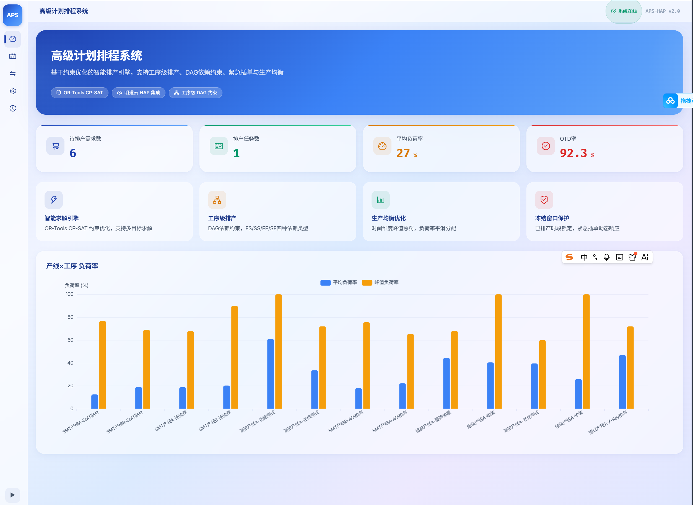
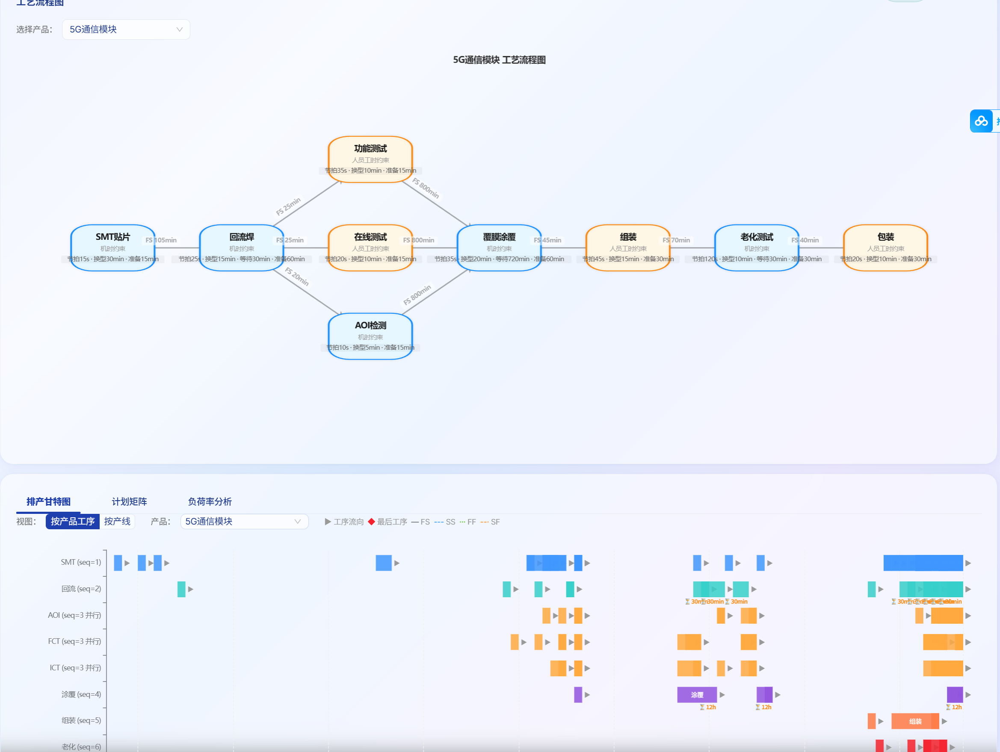
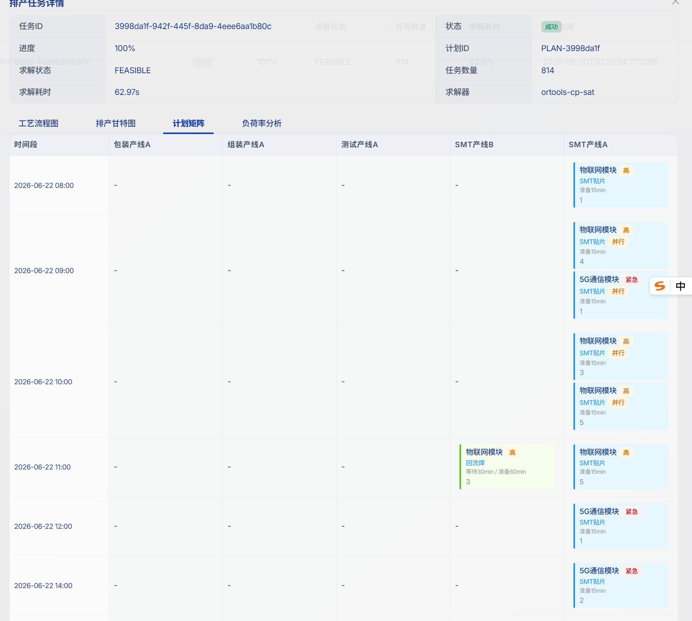
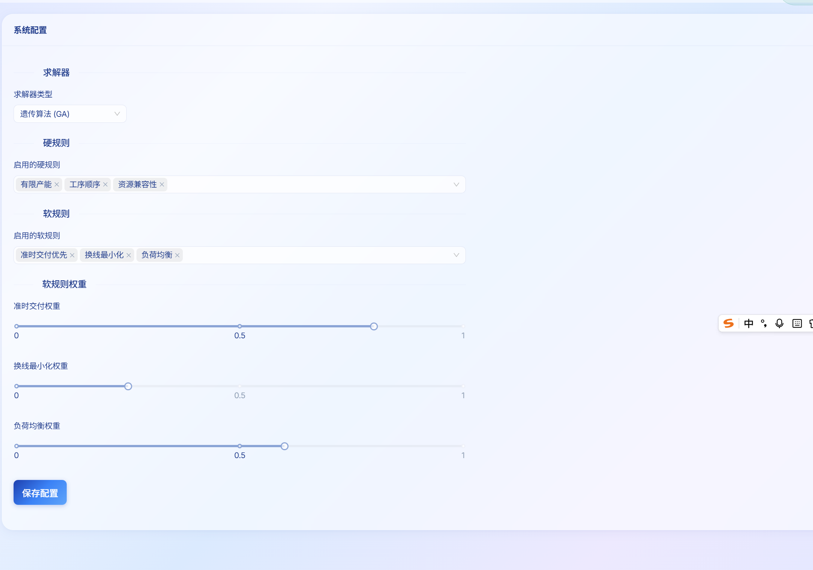

<div align="center">

# APS-HAP

**基于约束优化的智能排产系统**

[](https://python.org)
[](https://react.dev)
[](https://fastapi.tiangolo.com)
[](https://github.com/google/or-tools)
[](LICENSE)

*瓶颈决定产出，约束定义最优。*

</div>

---

## 为什么需要 APS-HAP？

制造业的车间排产是一个经典的 NP-Hard 问题。当你的产线有 5 条、产品有 5 种、工序有 10 道、时间精度到小时——人工排产已经不可能在合理时间内找到最优解。

传统 ERP 只能告诉你"缺什么"，MRP 只能做无限产能的粗排。**APS-HAP 解决的是更本质的问题：在有限产能和工艺约束下，先做什么、后做什么、每道工序排到哪个时段。**

这不是甘特图的拖拽游戏。我们的求解引擎在数万维变量空间中搜索最优解，每一条约束都经过数学证明。

### 当前阶段

> ⚠️ **Phase 1 — 工艺约束排产**：已实现产能约束和工艺关系约束的工序级排产，尚未涉及机时、人员工时、物料等资源级约束（Phase 2 规划中）。

## 界面预览

<table>
  <tr>
    <td align="center"><b>仪表盘 — 实时数据概览</b></td>
    <td align="center"><b>排产编制 — 工艺流程图 + 甘特图</b></td>
  </tr>
  <tr>
    <td></td>
    <td></td>
  </tr>
  <tr>
    <td align="center"><b>排产任务 — 需求计划管理</b></td>
    <td align="center"><b>系统设置 — 产线与工艺配置</b></td>
  </tr>
  <tr>
    <td></td>
    <td></td>
  </tr>
</table>

## 功能特性

### 已实现

- **工序级排产** — 精确到工序、精确到小时的排产计划，而非粗粒度的日级排程
- **DAG 串并行模型** — 真实工艺路线的数学建模，支持串行和并行工序
- **四种依赖类型** — FS（完成-开始）、SS（开始-开始）、FF（完成-完成）、SF（开始-完成）
- **等待时间约束** — 如涂覆后 12 小时固化等待，支持"是否计入下班时间"
- **产能约束** — 日产能/小时产能，按(产线×工序)对精确计算
- **冻结窗口** — 已排产时段锁定，避免计划频繁变更
- **紧急插单** — 动态优先级响应，紧急需求自动前置
- **生产均衡优化** — 时间维度峰值惩罚，避免负荷率忽高忽低
- **换线矩阵** — 产品切换成本建模，减少无效换线
- **双求解引擎** — OR-Tools CP-SAT（精确解）+ DEAP GA（启发式解）
- **HAP 数据同步** — 明道云 HAP 双向数据同步，14 张工作表全覆盖
- **订单级筛选** — 甘特图支持按订单（dp_code）筛选，同产品不同订单独立显示
- **工序排产单管理** — 工序级排产单（PSO）的完整 CRUD，含报工状态跟踪
- **负荷率曲线分析** — 按产线×日期的负荷率曲线图，负荷率=排产时间/产能时间(10.5h)
- **实际起止时间排产** — 任务时间槽包含实际起止时间（开始时间槽+total_time），甘特图柱子精确显示
- **报工数据闭环** — 派工单↔报工工单↔工序排产单三表数据一致性保证

### 规划中

- **机时约束** — 设备级排程，设备维护日历
- **人员工时约束** — 技能矩阵，班次排程
- **物料约束** — 齐套检查，缺料预警
- **模具/夹具约束** — 共享资源冲突检测
- **多目标优化** — 交期 + 换线 + 均衡 + 能耗的 Pareto 前沿
- **What-if 场景模拟** — 多方案对比，决策支持
- **多工厂协同排产** — 跨工厂产能协调

## 技术栈

### 为什么选择这些技术？

| 层 | 技术 | 选择理由 | 已知局限 |
|---|------|---------|---------|
| **求解引擎** | OR-Tools CP-SAT | 唯一开源的工业级约束规划求解器；OPTIMAL 解保证；Google 维护 | 单线程求解；浮点目标需整数化；内存随变量数增长 |
| **求解引擎** | DEAP GA | 灵活的适应度函数；天然支持非线性目标；可并行评估 | 无最优保证；种群规模敏感；早熟收敛风险 |
| **后端** | FastAPI + Python | 异步高性能；自动 OpenAPI 文档；与求解引擎同语言 | 生态不如 Django 成熟 |
| **数据校验** | Pydantic V2 | Rust 加速验证；JSON Schema 生成 | V1→V2 迁移有破坏性变更 |
| **数据源** | 明道云 HAP | 零代码建表；业务人员可直接维护主数据；工作流联动 | API 日期筛选不生效；选项字段写入需传 key；批量更新受限 |
| **前端** | React 18 + Ant Design 5 | 企业级组件齐全；中文友好；CSS-in-JS 主题定制 | 包体积大；默认样式辨识度高 |
| **图表** | ECharts 5 | custom series 灵活实现甘特图；中文文档完善 | 大数据量需手动优化；API 偏命令式 |
| **状态管理** | Zustand + React Query | 极简 API；缓存/重试/轮询开箱即用 | 各有局限但互补 |

### 与其他 APS 方案对比

| 维度 | APS-HAP | 商业 APS (如 Opcenter) | 开源 ERP 排产模块 |
|------|---------|----------------------|-------------------|
| **求解质量** | OPTIMAL（数学证明最优） | 启发式（无最优保证） | 有限产能粗排 |
| **工序精度** | 工序级 + 小时级 | 工序级 + 分钟级 | 日级 |
| **依赖类型** | FS/SS/FF/SF 四种 | 通常仅 FS | 通常仅 FS |
| **部署成本** | 开源免费 | 百万级年费 | 开源但需定制 |
| **数据维护** | HAP 零代码建表 | 专业实施团队 | 需开发人员 |
| **成熟度** | Phase 1（工艺约束） | 20+ 年工业验证 | 基础功能 |

## 工艺模型

真实产线的工艺路线不是简单的线性流程。以 SMT 电子制造为例：

```
                    ┌─→ AOI检测 ─┐
SMT贴片 → 回流焊 ──┤             ├─→ ICT → FCT ──┐
                    └─────────────┘                ├─→ 涂覆 → 组装 → 老化 → 包装
                    ┌─→ X-Ray ──┐                  │
                    └───────────┘──────────────────┘
```

- **串行工序**：前驱完成后才能开始后继（FS：Finish-to-Start）
- **并行工序**：同一层级的多道工序可同时执行（AOI/X-Ray 同步检测）
- **等待时间**：涂覆后需等待 12 小时才能组装（化学反应固化），支持"是否计入下班时间"

## 明道云 HAP 数据模型

APS-HAP 使用明道云 HAP 作为主数据平台，共 14 张工作表。鉴权信息（App ID、App Key、Sign）在**系统设置页面**中配置，不硬编码在代码中。

### 工作表一览

| 工作表 | 别名 | 用途 |
|--------|------|------|
| 产品主数据 | `product` | 产品基本信息和编码 |
| 工艺信息 | `process_info` | 10 道工序定义及约束参数 |
| 产线 | `production_line` | 产线基本信息和日产能 |
| 产品工艺 | `product_process` | 产品→工序多对多关系 |
| 产线工艺配置 | `line_process_config` | 产线→工序能力映射 |
| 物料主数据 | `material_master` | 物料基本信息 |
| 工序BOM | `process_bom` | 工序级物料需求 |
| 物料齐套 | `material_kitting` | 工序级物料约束 |
| 需求计划 | `demand_plan` | 客户需求及交期 |
| 排产结果 | `schedule_result` | 排产输出的工序级任务 |
| 资源日历(小时) | `resource_calendar` | 小时时段产能数据 |
| 换线矩阵 | `changeover_matrix` | 产品切换成本 |
| 缓冲配置 | `buffer_config` | 工序间缓冲时间 |
| 排产方案 | `schedule_plan` | 排产方案元数据 |

### 各表字段说明

#### 产品主数据 (`product`)

| 字段别名 | 类型 | 含义 |
|----------|------|------|
| `prod_code` | 文本 | 产品编码（如 PROD-5G-01） |
| `prod_name` | 文本 | 产品名称（如 5G通信模块） |
| `prod_category` | 选项 | 产品分类 |
| `prod_spec` | 文本 | 产品规格 |

#### 工艺信息 (`process_info`)

| 字段别名 | 类型 | 含义 |
|----------|------|------|
| `proc_code` | 文本 | 工序编码（如 PROC-SMT-01） |
| `proc_name` | 文本 | 工序名称（如 SMT贴片） |
| `constraint_type` | 选项 | 约束类型：机时约束 / 人员工时约束 |
| `wait_time` | 数值 | 等待时间（分钟），如涂覆后 720 分钟 |
| `wait_includes_offhours` | 布尔 | 等待是否计入下班时间（默认 True） |
| `prep_time` | 数值 | 准备时间（分钟） |

#### 产线 (`production_line`)

| 字段别名 | 类型 | 含义 |
|----------|------|------|
| `line_code` | 文本 | 产线编码（如 LINE-SMT-A） |
| `line_name` | 文本 | 产线名称（如 SMT产线A） |
| `line_capacity` | 数值 | 日产能 |
| `line_type` | 选项 | 产线类型 |

#### 产品工艺 (`product_process`)

| 字段别名 | 类型 | 含义 |
|----------|------|------|
| `pp_product` | 关联 | 关联产品主数据 |
| `pp_process` | 关联 | 关联工艺信息 |
| `seq` | 数值 | 工序顺序（同 seq 值 = 并行工序） |
| `std_time` | 数值 | 标准工时（分钟/件） |
| `dependency_type` | 选项 | 依赖类型：FS/SS/FF/SF |

#### 产线工艺配置 (`line_process_config`)

| 字段别名 | 类型 | 含义 |
|----------|------|------|
| `lpc_line` | 关联 | 关联产线 |
| `lpc_process` | 关联 | 关联工艺信息 |
| `daily_capacity` | 数值 | 该(产线,工序)对的日产能 |
| `efficiency` | 数值 | 效率百分比 |
| `equipment_count` | 数值 | 设备数量 |
| `worker_count` | 数值 | 人员数量 |
| `is_bottleneck` | 布尔 | 是否瓶颈工序 |

#### 物料主数据 (`material_master`)

| 字段别名 | 类型 | 含义 |
|----------|------|------|
| `mat_code` | 文本 | 物料编码 |
| `mat_name` | 文本 | 物料名称 |
| `mat_type` | 选项 | 物料类型 |
| `unit` | 文本 | 计量单位 |

#### 工序BOM (`process_bom`)

| 字段别名 | 类型 | 含义 |
|----------|------|------|
| `pb_product` | 关联 | 关联产品 |
| `pb_process` | 关联 | 关联工序 |
| `pb_material` | 关联 | 关联物料 |
| `quantity` | 数值 | 单位用量 |

#### 物料齐套 (`material_kitting`)

| 字段别名 | 类型 | 含义 |
|----------|------|------|
| `mk_product` | 关联 | 关联产品 |
| `mk_process` | 关联 | 关联工序 |
| `mk_material` | 关联 | 关联物料 |
| `required_qty` | 数值 | 需求数量 |
| `available_qty` | 数值 | 可用数量 |
| `shortage_qty` | 数值 | 缺料数量 |
| `kitting_date` | 日期 | 齐套日期 |

#### 需求计划 (`demand_plan`)

| 字段别名 | 类型 | 含义 |
|----------|------|------|
| `dp_code` | 文本 | 需求编码 |
| `dp_product` | 关联 | 关联产品 |
| `dp_quantity` | 数值 | 需求数量 |
| `dp_due_date` | 日期 | 交货日期 |
| `dp_priority` | 选项 | 优先级：普通/紧急 |
| `dp_status` | 选项 | 状态：待确认/已确认/已排产 |

#### 排产结果 (`schedule_result`)

| 字段别名 | 类型 | 含义 |
|----------|------|------|
| `sr_product` | 关联 | 关联产品 |
| `sr_process` | 关联 | 关联工序 |
| `sr_line` | 关联 | 关联产线 |
| `sr_demand_plan` | 关联 | 关联需求计划 |
| `sr_date` | 日期 | 排产日期 |
| `sr_time_slot` | 文本 | 时间段（如 H08-H09） |
| `sr_quantity` | 数值 | 排产数量 |
| `sr_status` | 选项 | 状态：已排产/已下发/已完成 |

#### 资源日历 (`resource_calendar`)

| 字段别名 | 类型 | 含义 |
|----------|------|------|
| `rc_code` | 文本 | 资源编码（含产线+工序+日期+时段） |
| `rc_date` | 日期 | 日期 |
| `rc_hour` | 数值 | 小时时段（8-19） |
| `rc_line` | 关联 | 关联产线 |
| `rc_process` | 关联 | 关联工序 |
| `available_capacity` | 数值 | 可用产能 |
| `is_working` | 布尔 | 是否工作时段 |

#### 换线矩阵 (`changeover_matrix`)

| 字段别名 | 类型 | 含义 |
|----------|------|------|
| `from_product` | 关联 | 源产品 |
| `to_product` | 关联 | 目标产品 |
| `setup_time` | 数值 | 换线时间（分钟） |

#### 缓冲配置 (`buffer_config`)

| 字段别名 | 类型 | 含义 |
|----------|------|------|
| `bc_process` | 关联 | 关联工序 |
| `buffer_time` | 数值 | 缓冲时间（分钟） |

#### 排产方案 (`schedule_plan`)

| 字段别名 | 类型 | 含义 |
|----------|------|------|
| `sp_name` | 文本 | 方案名称 |
| `sp_status` | 选项 | 方案状态 |
| `sp_start_date` | 日期 | 排产开始日期 |
| `sp_end_date` | 日期 | 排产结束日期 |
| `sp_solver` | 选项 | 求解器类型 |

## 快速开始

### 前置条件

- Python 3.11+
- Node.js 18+
- 明道云 HAP 账号

### 1. 克隆项目

```bash
git clone https://github.com/ceasarboy/HAPZS-APS.git
cd HAPZS-APS
```

### 2. 后端启动

```bash
cd backend
pip install -r requirements.txt

# 配置环境变量（HAP 鉴权信息也可在系统设置页面配置）
cp .env.example .env

# 启动服务
python -m uvicorn app.main:app --host 0.0.0.0 --port 8000 --reload
```

### 3. 前端启动

```bash
cd frontend
npm install
npm run dev
```

### 4. 配置 HAP 连接

访问 http://localhost:3000，进入**系统设置**页面，填写明道云 HAP 连接信息：

- **App ID** — 明道云应用 ID
- **App Key** — 明道云 API 密钥
- **Sign** — 明道云签名（在 HAP 管理后台获取）
- **Base URL** — API 地址（默认 `https://api.mingdao.com`）

### 5. 初始化 HAP 工作表

```bash
cd scripts
python create_hap_tables.py    # 创建 14 张工作表
python insert_test_data.py     # 写入测试数据
```

### Docker 部署

```bash
cd deploy
docker-compose up -d
```

## 项目结构

```
HAPZS-APS/
├── backend/
│   ├── app/
│   │   ├── api/v1/                  # REST API 端点
│   │   ├── core/                    # 配置与安全
│   │   │   ├── config.py            # 环境变量配置
│   │   │   └── app_config.py        # 运行时配置（HAP 鉴权等）
│   │   ├── engine/                  # 求解引擎核心
│   │   │   ├── constraint_builder.py  # 约束构建器
│   │   │   ├── solver_ortools.py      # CP-SAT 求解器
│   │   │   └── solver_ga_deap.py      # GA 求解器
│   │   ├── hap/                     # HAP API 客户端
│   │   ├── services/                # 业务逻辑层
│   │   └── schemas/                 # Pydantic 数据模型
│   └── requirements.txt
├── frontend/
│   ├── src/
│   │   ├── components/              # 业务组件
│   │   │   ├── GanttChart/          # 排产甘特图
│   │   │   ├── ProcessFlow/         # 工艺流程图（DAG 可视化）
│   │   │   ├── PlanMatrix/          # 计划矩阵
│   │   │   └── LoadChart/           # 负荷率分析
│   │   ├── pages/                   # 页面组件
│   │   └── api/                     # API 调用层
│   └── package.json
├── deploy/                          # Docker 部署配置
│   └── worksheet_ids_v2.json        # HAP 工作表 ID 映射
├── docs/                            # 设计文档
└── scripts/                         # HAP 数据初始化脚本
```

## 性能基准

测试环境：5 产品 / 5 产线 / 10 工序 / 36 工艺路线 / 806 小时时段

| 场景 | 展开项 | 求解器 | 状态 | 耗时 |
|------|--------|--------|------|------|
| 基础排产 | 545 | CP-SAT | OPTIMAL | 36.9s |
| DAG 并行 | 551 | CP-SAT | OPTIMAL | 35.7s |
| 倒序修复 | 678 | CP-SAT | OPTIMAL | 17.9s |
| 冻结窗口 | 551 | CP-SAT | OPTIMAL | 22.3s |
| 紧急插单 | 770 | CP-SAT | FEASIBLE | 63.0s |
| 生产均衡 | 551 | CP-SAT | OPTIMAL | 28.5s |

## 路线图

- [x] **Phase 1** — 工艺约束排产（产能 + 工艺关系 + DAG 串并行）
- [ ] **Phase 2** — 资源约束排产（机时 + 人员工时 + 物料齐套）
- [ ] **Phase 3** — 智能优化（多目标 + What-if + 需求预测 + 多工厂）

## 致谢

- [OR-Tools](https://github.com/google/or-tools) — Google 开源约束规划引擎
- [DEAP](https://github.com/DEAP/deap) — 进化算法框架
- [明道云 HAP](https://www.mingdao.com/) — 低代码数据平台
- [Ant Design](https://ant.design/) — 企业级 UI 组件库
- [ECharts](https://echarts.apache.org/) — 数据可视化引擎

## License

[MIT](LICENSE)
