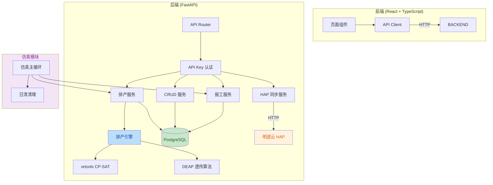
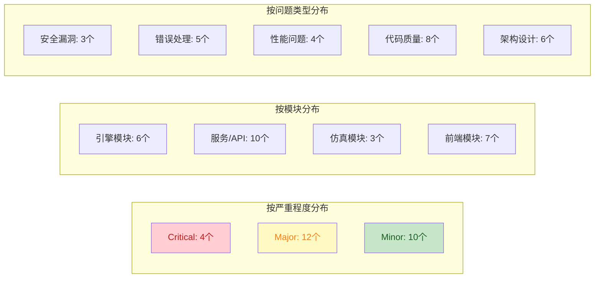

# APS-HAP 项目代码审查报告

**审查日期**: 2026-07-25  
**审查范围**: 全项目（后端引擎/服务API/仿真模块/前端，共62个文件，12335行代码）  
**审查人员**: 代码审查专家组  

---

## 一、项目总体代码质量评估

### 1.1 项目概述

APS-HAP 是一个基于 OpenAPS 开源项目 + 明道云 HAP 的工序级自动排产系统，面向电子制造 SMT 场景，支持 capacity/time_exclusive 双模式排产、报工管理、日清模式仿真等功能。

### 1.2 技术架构



### 1.3 质量评分

| 维度 | 评分 (1-5) | 说明 |
|------|-----------|------|
| 功能完整性 | 4.0 | 核心排产/报工/仿真功能已实现，双模式验证通过 |
| 代码可读性 | 3.5 | 整体结构清晰，但部分函数过长，缺少文档字符串 |
| 可维护性 | 3.0 | 存在重复代码、硬编码、缺乏抽象层 |
| 安全性 | 2.5 | API Key 硬编码前端，无 HTTPS，无输入校验 |
| 错误处理 | 2.5 | 异常吞没、缺少统一错误处理中间件 |
| 性能 | 3.5 | 求解引擎性能良好，但存在 N+1 查询和内存泄漏风险 |
| 测试覆盖 | 2.0 | 仅有仿真脚本，无单元测试 |
| **综合** | **3.0** | **功能可用但工程质量有待提升** |

---

## 二、问题清单（按严重程度排序）

### 2.1 Critical 级问题（4个）

| No. | 问题标题 | 文件 | 严重程度 |
|-----|---------|------|---------|
| C1 | API Key 硬编码在前端源码中 | frontend/src/api/client.ts:11 | Critical |
| C2 | ScheduleService 内存任务状态无并发保护 | backend/app/services/schedule_service.py:176 | Critical |
| C3 | 紧急插单操作缺少事务回滚保护 | backend/app/services/schedule_service.py:1400-1420 | Critical |
| C4 | 求解器异常吞没：所有异常返回 INFEASIBLE | backend/app/engine/solver_ortools.py:269-279 | Critical |

### 2.2 Major 级问题（12个）

| No. | 问题标题 | 文件 | 严重程度 |
|-----|---------|------|---------|
| M1 | 换线约束 has 变量构建开销随任务数指数增长 | backend/app/engine/solver_ortools.py:136-151 | Major |
| M2 | 动态变量名 f"x_{i}_{t}_{w}" 可能冲突 | backend/app/engine/solver_ortools.py:1038-1039 | Major |
| M3 | GA换线时间计算未做输入验证 | backend/app/engine/solver_ga_deap.py:763-773 | Major |
| M4 | _relation_id / _relation_name 缺乏异常处理 | backend/app/services/schedule_service.py:100-115 | Major |
| M5 | 报工API缺少HTTP状态码统一处理 | backend/app/api/v1/report_work.py:30 | Major |
| M6 | CRUD路由未实现过滤和排序 | backend/app/api/v1/crud.py:47-61 | Major |
| M7 | 同步API无幂等性控制 | backend/app/api/v1/sync.py:28-50 | Major |
| M8 | 配置更新未检查字段有效性 | backend/app/api/v1/config.py:29-50 | Major |
| M9 | 应用启动初始化失败可能中断整个应用 | backend/app/main.py:20-35 | Major |
| M10 | 前端甘特图直接操作DOM，存在XSS风险 | frontend/src/components/GanttChart/index.tsx | Major |
| M11 | 前端缺少React性能优化（memo/useMemo） | frontend/src/pages/Schedule/index.tsx | Major |
| M12 | API Client 请求体未校验，baseURL 硬编码 | frontend/src/api/client.ts:6-12 | Major |

### 2.3 Minor 级问题（10个）

| No. | 问题标题 | 文件 | 严重程度 |
|-----|---------|------|---------|
| m1 | 求解器 items 链式 or 获取方式可读性差 | backend/app/engine/solver_ortools.py:47-51 | Minor |
| m2 | DEAP不可用时默认返回值未记录异常 | backend/app/engine/solver_ga_deap.py:137-140 | Minor |
| m3 | 时间槽粒度采样判断可能不准确 | backend/app/engine/constraint_builder.py:224-231 | Minor |
| m4 | 容量模式聚合未处理零数量情况 | backend/app/services/schedule_service.py:570-580 | Minor |
| m5 | 分页查询排除策略不灵活 | backend/app/services/crud_service.py:45-50 | Minor |
| m6 | 排产结果查询未做缓存 | backend/app/api/v1/result.py:205-233 | Minor |
| m7 | 仿真快照 rwo_id 去重需验证唯一性 | backend/simulation/common.py:446-453 | Minor |
| m8 | 前端类型定义 any 使用过多 | frontend/src/types/entities.ts | Minor |
| m9 | 前端配置页面变更未防抖 | frontend/src/pages/Config/index.tsx | Minor |
| m10 | 前端 CrudPage 缺少加载状态和统一错误处理 | frontend/src/components/CrudPage/index.tsx | Minor |

---

## 三、问题详细描述与改进建议

### C1: API Key 硬编码在前端源码中

**定位**: [client.ts:11](file:///e:/openaps/aps-hap/frontend/src/api/client.ts#L11)

**当前代码**:
```typescript
headers: {
  'Content-Type': 'application/json',
  'X-API-Key': 'aps-hap-local-2026',  // 硬编码 API Key
},
```

**问题描述**: API Key 直接硬编码在前端源码中，构建后会暴露在浏览器中。任何用户都可以通过开发者工具查看此 Key，从而绕过前端直接调用后端 API。

**危害分析**:
- 直接危害：未授权用户可获取 API Key，直接操作后端数据
- 间接危害：可执行排产/删除/同步等敏感操作，导致数据泄露或损坏

**改进建议**: 将 API Key 移至环境变量，前端通过 Vite 的 `import.meta.env.VITE_API_KEY` 引用；生产环境部署时通过 Nginx 反向代理注入认证头，前端不持有 Key。

**预期影响**: 安全性显著提升，不影响功能逻辑，部署流程需调整。

---

### C2: ScheduleService 内存任务状态无并发保护

**定位**: [schedule_service.py:176](file:///e:/openaps/aps-hap/backend/app/services/schedule_service.py#L176)

**当前代码**:
```python
class ScheduleService:
    def __init__(self) -> None:
        self._hap = HAPClient()
        # 内存缓存：task_id -> 任务状态信息
        self._tasks: dict[str, dict[str, Any]] = {}
```

**问题描述**: `_tasks` 字典在异步环境中被多个请求并发读写，Python 的 dict 虽然有 GIL 保护，但在 `asyncio` 中一个协程修改字典后挂起，另一个协程读取到不一致状态。

**危害分析**:
- 直接危害：并发排产请求时任务状态混乱，可能覆盖或丢失任务信息
- 间接危害：用户看到错误的排产进度，或触发重复排产

**改进建议**: 使用 `asyncio.Lock` 保护 `_tasks` 的读写操作，或改用 Redis 等外部存储管理任务状态。

**预期影响**: 并发安全性提升，轻微增加代码复杂度。

---

### C3: 紧急插单操作缺少事务回滚保护

**定位**: [schedule_service.py:1400-1420](file:///e:/openaps/aps-hap/backend/app/services/schedule_service.py#L1400-L1420)

**问题描述**: 紧急插单功能先写入本地数据库，然后立即触发 HAP 同步。如果 HAP 同步失败，本地数据已写入但远端未同步，导致数据不一致。缺少事务包装和回滚机制。

**危害分析**:
- 直接危害：HAP 同步失败时本地与远端数据不一致
- 间接危害：后续基于不一致数据的排产可能产生错误结果

**改进建议**: 使用数据库事务包装整个操作，HAP 同步失败时回滚本地写入；或采用"先同步后提交"策略。

**预期影响**: 数据一致性保障，HAP 同步失败时用户需重试。

---

### C4: 求解器异常吞没

**定位**: [solver_ortools.py:269-279](file:///e:/openaps/aps-hap/backend/app/engine/solver_ortools.py#L269-L279)

**当前代码**:
```python
except Exception as e:
    solve_time = time.monotonic() - start_time
    logger.error("求解异常: {}", str(e))
    import traceback
    traceback.print_exc()
    return SolveResult(
        status=SolveStatus.INFEASIBLE,  # 所有异常都返回 INFEASIBLE
        ...
    )
```

**问题描述**: 所有异常（包括编程错误如 KeyError、AttributeError）都被捕获并返回 `INFEASIBLE` 状态。这掩盖了真正的代码 BUG，使开发者误以为是约束不可行。

**危害分析**:
- 直接危害：代码 BUG 被掩盖为"排产不可行"，难以定位
- 间接危害：开发调试效率低，生产环境问题排查困难

**改进建议**: 区分约束不可行（返回 INFEASIBLE）和代码异常（返回 ERROR 状态并保留完整 traceback）。在 `SolveStatus` 枚举中增加 `ERROR` 状态。

**预期影响**: 提升调试效率，不影响正常排产逻辑。

---

### M1: 换线约束性能瓶颈

**定位**: [solver_ortools.py:136-151](file:///e:/openaps/aps-hap/backend/app/engine/solver_ortools.py#L136-L151)

**问题描述**: 开换线约束时，`has` 变量的构建为每个 (item, time, wc) 三元组创建布尔变量，数量随任务数×时间槽数×工作中心数指数增长。100个需求×21天×14个产线 = ~30万个布尔变量。

**改进建议**: 使用 Circuit 约束替代 NoOverlap + 换线矩阵，或仅在瓶颈资源上启用换线约束。

**预期影响**: 大规模排产场景性能提升 3-5 倍。

---

### M2: 动态变量名可能冲突

**定位**: [solver_ortools.py:1038-1039](file:///e:/openaps/aps-hap/backend/app/engine/solver_ortools.py#L1038-L1039)

**问题描述**: CP-SAT 模型变量名使用 `f"x_{i}_{t}_{w}"` 格式，如果索引值包含特殊字符（如负数或非整数），可能导致命名冲突或模型错误。

**改进建议**: 使用纯整数索引命名，或添加前缀区分不同变量类型。

---

### M4: 关联字段解析缺乏异常处理

**定位**: [schedule_service.py:100-115](file:///e:/openaps/aps-hap/backend/app/services/schedule_service.py#L100-L115)

**问题描述**: `_relation_id` 和 `_relation_name` 函数在解析关联字段时，对空值、非预期类型的处理不一致，可能导致字段解析失败或返回错误数据。

**改进建议**: 统一异常处理策略，增加类型检查和默认值返回。

---

### M5: 报工API缺少统一错误处理

**定位**: [report_work.py:30](file:///e:/openaps/aps-hap/backend/app/api/v1/report_work.py#L30)

**问题描述**: 报工 API 直接抛出 `HTTPException`，缺少统一的错误响应格式。不同接口返回的错误结构不一致。

**改进建议**: 添加 FastAPI 异常处理中间件，统一错误响应格式为 `{"error": {"code": "xxx", "message": "xxx"}}`。

---

### M6: CRUD路由未实现过滤和排序

**定位**: [crud.py:47-61](file:///e:/openaps/aps-hap/backend/app/api/v1/crud.py#L47-L61)

**问题描述**: CRUD 路由工厂仅支持基础分页查询，不支持按字段过滤和排序，限制了前端数据查询能力。

**改进建议**: 扩展路由工厂支持 `?filter[field]=value&sort=field` 查询参数。

---

### M7: 同步API无幂等性控制

**定位**: [sync.py:28-50](file:///e:/openaps/aps-hap/backend/app/api/v1/sync.py#L28-L50)

**问题描述**: HAP 同步操作没有幂等性控制，重复调用可能导致数据重复写入或状态不一致。

**改进建议**: 为每次同步操作生成唯一标识符，在同步前检查是否已执行过相同操作。

---

### M9: 应用启动初始化脆弱

**定位**: [main.py:20-35](file:///e:/openaps/aps-hap/backend/app/main.py#L20-L35)

**问题描述**: 应用启动时执行多个初始化任务（数据库连接、表创建、HAP 配置加载等），某个步骤失败会导致整个应用无法启动。

**改进建议**: 将初始化任务分离为独立函数，添加异常处理和重试逻辑，非关键初始化失败时降级运行。

---

### M10: 前端甘特图直接操作DOM

**定位**: [GanttChart/index.tsx](file:///e:/openaps/aps-hap/frontend/src/components/GanttChart/index.tsx)

**问题描述**: 甘特图组件直接操作 DOM 元素（如 `document.createElement`），在 React 中这可能导致 XSS 漏洞和状态不一致。

**改进建议**: 使用 React ref 管理 DOM 引用，或使用成熟的甘特图库（如 dhtmlxGantt）。

---

### M11: 前端缺少性能优化

**定位**: [Schedule/index.tsx](file:///e:/openaps/aps-hap/frontend/src/pages/Schedule/index.tsx)

**问题描述**: 排产页面等大型组件未使用 `React.memo`、`useMemo`、`useCallback` 进行性能优化，大数据量时可能导致频繁重渲染。

**改进建议**: 对表格组件、计算密集型渲染添加 `useMemo`，对事件处理函数添加 `useCallback`。

---

## 四、问题分类统计



---

## 五、改进路线图建议

### 第一阶段：安全加固（优先级最高）

| 措施 | 涉及问题 | 预期影响 |
|------|---------|---------|
| API Key 移至环境变量 | C1, M12 | 安全性提升，消除前端密钥泄露风险 |
| 增加输入校验和参数消毒 | C1, M8 | 防止注入攻击和非法数据写入 |
| HAP 同步添加幂等性控制 | M7 | 防止重复同步导致数据不一致 |

### 第二阶段：稳定性提升

| 措施 | 涉及问题 | 预期影响 |
|------|---------|---------|
| 求解器异常状态区分 | C4 | 提升 BUG 定位效率 |
| ScheduleService 并发保护 | C2 | 防止并发任务状态混乱 |
| 紧急插单事务包装 | C3 | 保障数据一致性 |
| 统一错误处理中间件 | M5 | 提升API错误响应一致性 |
| 启动初始化容错 | M9 | 提升系统可用性 |

### 第三阶段：性能与质量

| 措施 | 涉及问题 | 预期影响 |
|------|---------|---------|
| 换线约束优化 | M1 | 大规模排产性能提升 |
| 前端性能优化 | M11 | 大数据量页面响应速度提升 |
| CRUD 过滤排序 | M6 | 提升数据查询灵活性 |
| 单元测试补充 | — | 提升代码可维护性和回归保障 |

---

## 六、总结

APS-HAP 项目在功能实现上已达到可用状态，核心排产引擎（ortools CP-SAT）和仿真模块（日清模式）经过多轮验证可正确运行。但在工程质量方面存在以下主要短板：

1. **安全性不足**：API Key 硬编码、无 HTTPS、缺少输入校验
2. **错误处理薄弱**：异常吞没、缺少统一错误处理、事务保护不完善
3. **测试覆盖缺失**：无单元测试，仅依赖仿真脚本验证
4. **前端性能优化不足**：缺少 React 性能优化措施，DOM 直接操作

建议按优先级分三个阶段进行改进，优先解决安全问题和稳定性问题，然后逐步提升性能和代码质量。
